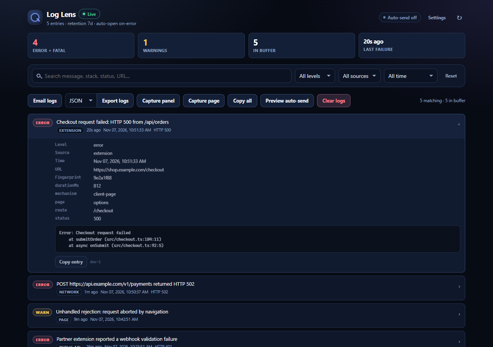
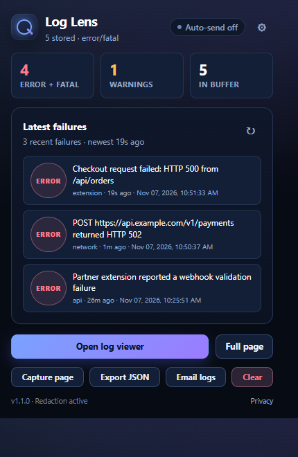
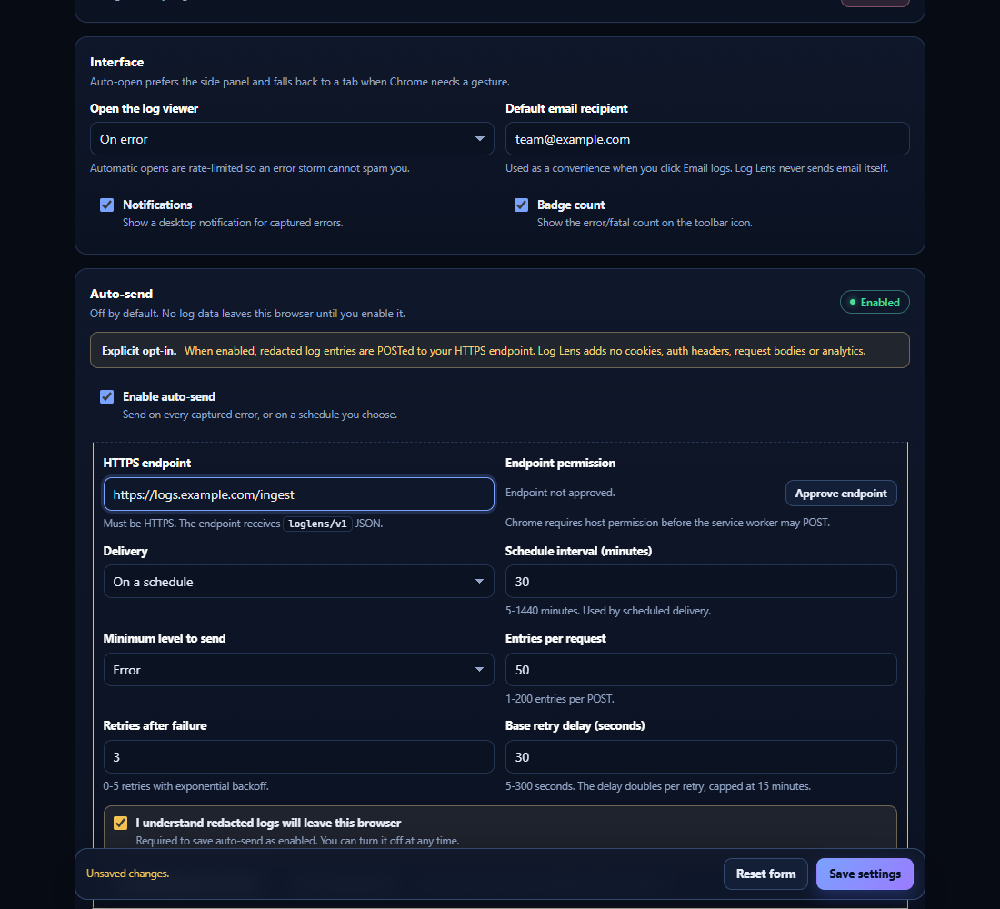
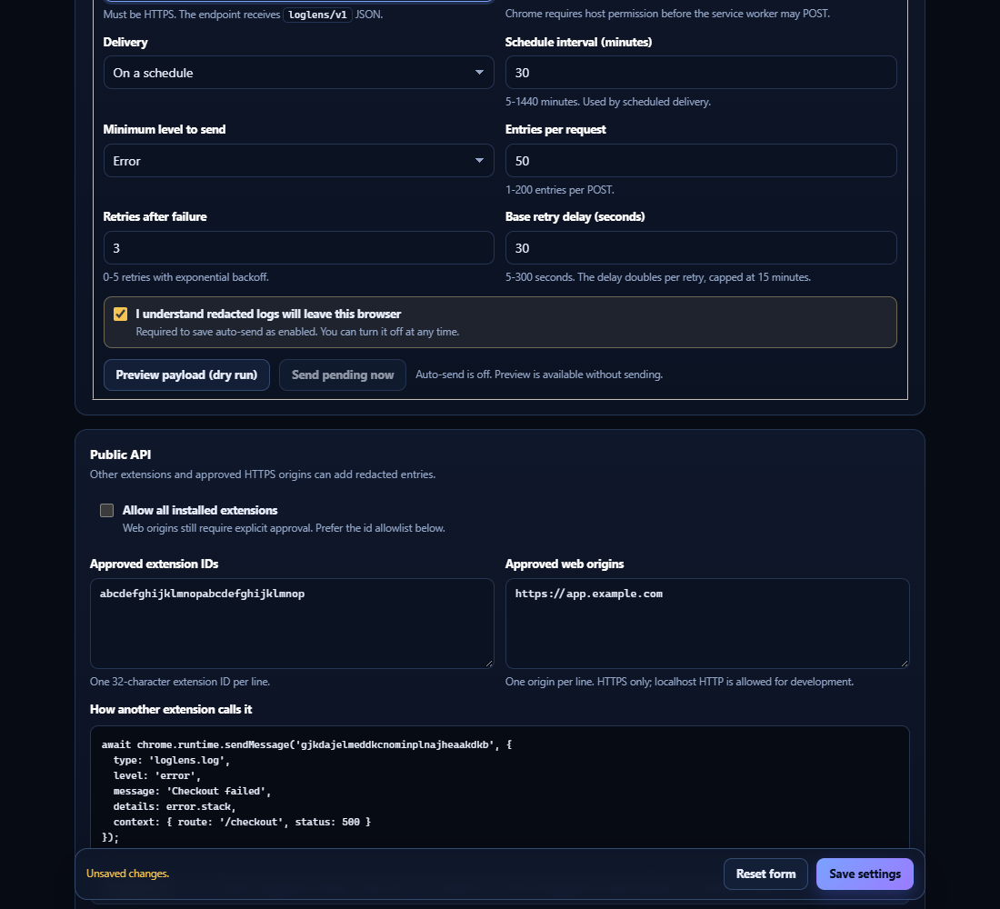
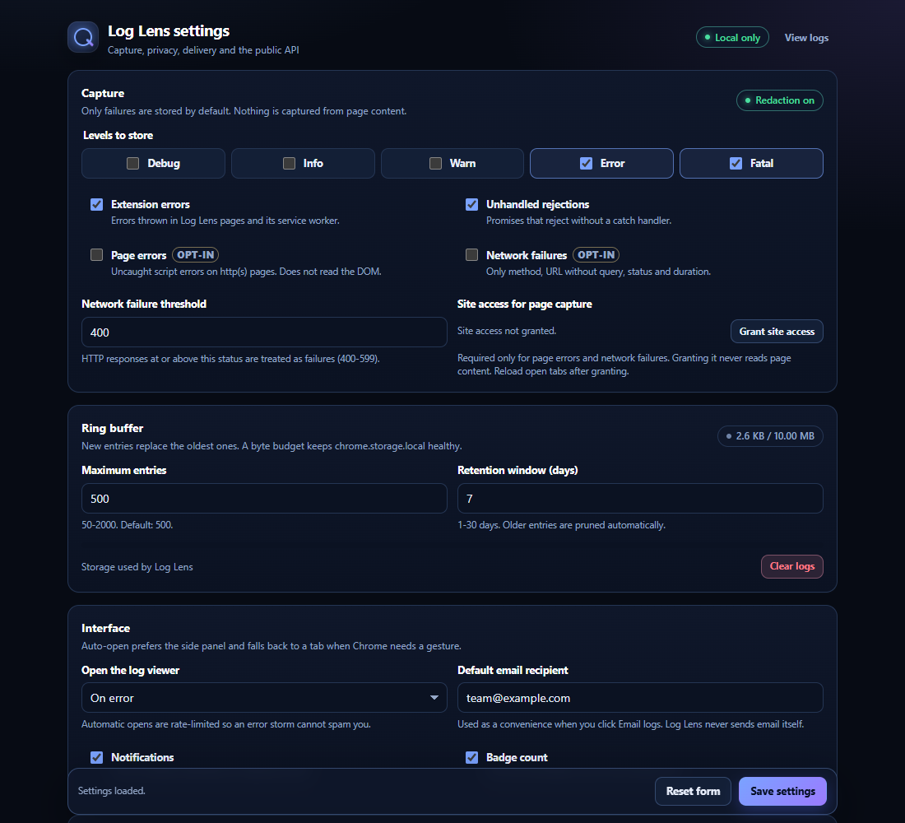

# Log Lens

[](LICENSE)
[](https://developer.chrome.com/docs/extensions/develop/migrate)
[](CHANGELOG.md)

Log Lens is a production-ready Chrome Manifest V3 extension that automatically
captures error and failure logs, redacts secrets, stores them in a bounded local
ring buffer, shows them in a live side panel, and lets you email, export,
screenshot or send them to a collector you control. It is private by default:
no analytics, no telemetry, no remote code, and no log data leaves the browser
until you explicitly enable auto-send.



## Features

- **Automatic capture**: extension errors, unhandled rejections, opt-in page
  errors and opt-in network failures.
- **Failure-only defaults**: error and fatal are stored; info/debug/warn are
  configurable.
- **Bounded ring buffer**: `chrome.storage.local`, configurable maximum entries,
  retention window and a 4.5 MB byte budget.
- **Auto-open**: never, on error or always. Prefers `chrome.sidePanel`; falls
  back to a `logs.html` tab when Chrome needs a user gesture.
- **Opt-in auto-send**: immediate or scheduled HTTPS POST, retries with
  exponential backoff, endpoint permission checks, explicit consent and a
  dry-run preview.
- **Manual actions**: Email Logs, Export Logs (JSON/CSV/text), Capture
  Screenshot (panel or visible page), Copy All, Clear Logs.
- **Complete UI**: popup summary, side-panel/full-page log viewer with search,
  level/source/time filters, options page, error-count badge, notifications and
  an `Alt+Shift+L` shortcut.
- **Public API**: `chrome.runtime.onMessageExternal` for approved extensions and
  approved HTTPS origins.
- **Privacy pipeline**: bearer headers, tokens, API keys, passwords, JWTs,
  cookies, private keys and URL credentials are redacted before storage,
  export, email or sending.
- **No dependencies at runtime** and no analytics.

## Installation

### Load the unpacked extension

```bash
pnpm install
pnpm build
```

1. Open `chrome://extensions`.
2. Enable **Developer mode**.
3. Click **Load unpacked**.
4. Select the generated `dist/` folder.

The options page opens on first install so you can review the defaults. Page
capture and auto-send are off.

### Install from a ZIP

```bash
pnpm zip
```

The package is written to `log-lens-1.1.0.zip`. Upload it to the Chrome Web
Store or unzip it and load the folder as an unpacked extension.

### Requirements

- Chrome 116 or newer (side panel support).
- Node.js 24+ for building and unit tests.
- pnpm 10+.

## What gets captured

| Source               | Default       | How to enable                                           | What is stored                           |
| -------------------- | ------------- | ------------------------------------------------------- | ---------------------------------------- |
| Extension errors     | On            | Always on                                               | Message, stack, small context            |
| Unhandled rejections | On            | Always on                                               | Message, stack, small context            |
| Page errors          | Off           | Settings → Capture → Page errors + host permission      | Message, stack, filename, line/column    |
| Network failures     | Off           | Settings → Capture → Network failures + host permission | Method, query-free URL, status, duration |
| Public API           | When approved | Settings → Public API                                   | Caller-supplied, redacted entry          |

Only levels selected in **Settings → Capture → Levels to store** are persisted.
The default is **error** and **fatal**. This is why a 404 warning is not stored
until you add `warn`, for example.

The ring buffer automatically removes entries older than the retention window
and trims the oldest entries when the maximum count or byte budget is reached.

## Auto-open

Choose **Settings → Interface → Open the log viewer**:

- **Never** — do nothing automatically.
- **On error** — open for `error` and `fatal` entries (default).
- **Always** — open for any captured entry.

Log Lens first tries `chrome.sidePanel.open()`. Chrome requires a user gesture
for side-panel opens, so an automatic open commonly fails. Log Lens then opens
`logs.html` in a tab instead. Automatic opens are rate-limited to one every 30
seconds and reuse an existing Log Lens tab when possible.



## Auto-send (opt-in)

Auto-send is **disabled by default** and cannot be enabled without:

1. A valid **HTTPS** endpoint.
2. Chrome host permission for that endpoint (click **Approve endpoint** or save
   the settings and accept the prompt).
3. Ticking **I understand redacted logs will leave this browser**.

Choose **immediately on error** or a schedule (5–1440 minutes). Every request is
a JSON `POST` with:

```json
{
  "schema": "loglens/v1",
  "product": "Log Lens",
  "version": "1.1.0",
  "sentAt": "2026-11-07T12:00:00.000Z",
  "reason": "immediate",
  "count": 2,
  "entries": [
    {
      "id": "…",
      "timestamp": 1794062400000,
      "level": "error",
      "source": "extension",
      "message": "Checkout failed",
      "details": "stack trace…",
      "context": { "route": "/checkout", "status": 500 },
      "url": "https://shop.example.com/checkout",
      "fingerprint": "9e2a1f88"
    }
  ]
}
```

Requests use `credentials: 'omit'`, `referrerPolicy: 'no-referrer'`, a 15-second
timeout and no auth headers. Failed requests retry with exponential backoff,
capped at 15 minutes. Changing the endpoint or disabling auto-send clears queued
batches so old data cannot be sent to a new destination.

**Preview payload (dry run)** builds the exact JSON in the options page without
sending anything. **Send pending now** is a separate explicit action.



## Email logs

Click **Email logs** in the log viewer. Log Lens builds a redacted digest of the
current filtered entries and opens your default mail application with a
`mailto:` link. Nothing is emailed automatically and no attachment is created.
Use **Export logs** for the complete file.

## Export logs

The viewer can export the current filtered result as:

- **JSON** — a versioned `loglens/export/v1` document with privacy flags and
  entries.
- **CSV** — spreadsheet-friendly columns.
- **Text** — a readable digest.

Exports and screenshots are generated and downloaded locally.

## Screenshots

- **Capture panel** serialises the rendered viewer through an SVG
  `foreignObject` (DOM-to-image) and downloads a PNG at 2× scale.
- **Capture page** asks Chrome for `captureVisibleTab`, requesting optional host
  access if needed, and downloads the visible tab as a PNG.

The panel capture includes only the Log Lens panel, not the page underneath.
The page capture is the active visible tab; when the side panel is open, that is
normally the page you are debugging.

## Privacy and redaction

Log Lens **never captures or stores** cookies, form data, request headers,
request bodies, response bodies, page content or DOM text. Page capture records
only the error message/stack and network method, query-free URL, status and
duration.

Before storage, export, email or sending, the redactor removes:

- `Authorization` / `Proxy-Authorization` bearer, basic and token values
- Cookies and session ids
- Passwords, passphrases, client secrets and private keys
- API keys and common provider tokens (OpenAI, GitHub, Slack, AWS, Google)
- JWTs and signed URL credentials
- Sensitive query parameters and URL userinfo

URLs are reduced to origin + path; query strings and fragments are dropped.

There are **no analytics, telemetry, ads or third-party scripts**. The extension
contains no remote code. See [privacy_policy.html](privacy_policy.html) for the
full policy.

## Public API

Other extensions can send logs through `chrome.runtime.onMessageExternal`.
Approval is explicit:

1. Open **Settings → Public API**.
2. Add the sender's 32-character extension id, or enable **Allow all installed
   extensions**.
3. For web apps, add the exact HTTPS origin (localhost HTTP is allowed for
   development).

The receiving extension id is visible in `chrome://extensions` and is injected
into the code sample on the options page.

### From another extension

```ts
const response = await chrome.runtime.sendMessage('<log-lens-extension-id>', {
  type: 'loglens.log',
  level: 'error',
  message: 'Checkout failed',
  details: error.stack,
  context: { route: '/checkout', status: 500 },
  url: 'https://app.example.com/checkout',
});
```

### From an approved web origin

```ts
chrome.runtime.sendMessage(
  '<log-lens-extension-id>',
  {
    type: 'loglens.log',
    level: 'warn',
    message: 'Payment widget timed out',
    context: { widget: 'payment', durationMs: 8000 },
  },
  (response) => console.log(response),
);
```

### API messages

| Type                   | Purpose                                                    |
| ---------------------- | ---------------------------------------------------------- |
| `loglens.log`          | Add a redacted entry. Requires sender approval.            |
| `loglens.ping`         | Health check; returns product and version.                 |
| `loglens.capabilities` | Returns accepted message type, levels and privacy summary. |

A successful add returns:

```json
{
  "ok": true,
  "stored": 1,
  "ignored": false,
  "ids": ["…"],
  "source": "approved-extension"
}
```

Unapproved senders get `{ "ok": false, "error": "not-approved", "reason": "..." }`.
Invalid payloads, overlong messages and rate limits (60 entries/minute per
sender) are rejected. Levels disabled in settings are accepted but ignored with
`"ignored": true`. The same redaction and retention pipeline applies.



## UI overview

- **Popup** — counts, latest failures, auto-send state, quick capture/export/
  email/clear actions.
- **Log viewer** (`logs.html`, also the side panel) — search, filters, expandable
  entries with stack traces and context, all manual actions, live updates.
- **Options** (`options.html`) — capture, ring buffer, interface, auto-send,
  public API and privacy controls.
- **Badge** — number of error/fatal entries in the buffer, red when non-zero.
- **Notifications** — optional error notification; clicking it opens the viewer.
- **Shortcut** — `Alt+Shift+L` opens the viewer. Configure it at
  `chrome://extensions/shortcuts`.



## Permissions

| Permission                   | Why Log Lens needs it                                             |
| ---------------------------- | ----------------------------------------------------------------- |
| `storage`                    | Ring buffer, settings, queue                                      |
| `alarms`                     | Retention, scheduled sending, retry backoff                       |
| `notifications`              | Optional error notification                                       |
| `sidePanel`                  | Preferred log viewer                                              |
| `scripting`                  | Register the opt-in page-capture content script                   |
| `activeTab`                  | Visible-tab screenshot after a user gesture                       |
| `clipboardWrite`             | Copy All / Copy entry                                             |
| Optional HTTP(S) host access | Page errors/network capture, page screenshots, auto-send endpoint |

Log Lens does **not** request `tabs`, `webRequest`, `cookies`, `history`,
`bookmarks`, `downloads` or `<all_urls>` at install time. Optional access is
requested only when you enable page capture, capture a page screenshot or
approve an auto-send endpoint.

## Development

### Commands

```bash
pnpm install          # Node 24+, pnpm 10+
pnpm dev              # rebuild pages + content scripts while you work
pnpm lint             # Biome lint + import order
pnpm lint:fix         # apply safe Biome fixes
pnpm format           # format supported files
pnpm format:check     # fail if formatting drifted
pnpm typecheck        # strict tsc --noEmit + unused checks
pnpm test             # unit tests (node:test, direct TS imports)
pnpm test:e2e         # Playwright with the built extension loaded
pnpm test:all         # unit + build + E2E
pnpm build            # bundles, static files, dist verification
pnpm verify:dist      # verify the built package on its own
pnpm icons            # regenerate PNG icons
pnpm docs:images      # regenerate README screenshots from the real extension
pnpm zip              # build and write log-lens-1.1.0.zip
```

The first E2E or docs run may need Playwright's Chromium:

```bash
pnpm exec playwright install chromium
```

### Project structure

```
log-lens/
├── src/
│   ├── core/                  # Types, settings, redaction, ring buffer, payloads, policy
│   ├── background/            # Service worker, storage, capture, auto-open, auto-send, API
│   ├── content/               # MAIN-world instrumentation + isolated bridge
│   └── ui/
│       ├── shared/            # DOM helpers, screenshots, messaging, CSS
│       ├── popup/             # Toolbar summary
│       ├── logs/              # Side panel / full-page viewer
│       └── options/           # Settings
├── popup.html                 # Vite entry points (output at dist root)
├── logs.html
├── options.html
├── tests/
│   ├── unit/                  # node:test suite
│   └── e2e/                   # Playwright with the extension loaded
├── scripts/                   # Build, tests, icons, docs, verification, ZIP
├── docs/images/               # README screenshots
├── manifest.json
├── CHANGELOG.md
└── README.md
```

### Architecture

- **Service worker** owns capture policy, storage writes, badge, notifications,
  auto-open, alarms and auto-send. Storage mutations are serialised to avoid
  lost updates.
- **Core modules** are DOM-free and chrome-free where possible, so they are
  unit-tested directly by Node with type stripping.
- **Content script** is split into a MAIN-world instrumentation bundle (page
  error, fetch and XHR hooks) and an isolated bridge. Both are classic IIFEs
  because Chrome content scripts cannot use ES modules. The bridge buffers early
  events until settings arrive and rate-limits itself.
- **UI pages** are ES modules built by Vite with shared CSS and typed message
  wrappers.
- **Auto-send** snapshots each batch at enqueue time; endpoint changes or
  disabling clears the queue. A single send lock prevents concurrent flushes.

### Unit tests

`pnpm test` covers:

- Settings defaults, clamping, enum validation, consent gating, allowlists.
- Redaction of headers, JSON secrets, provider tokens, JWTs, private keys, URL
  credentials and nested context (including false-positive guards).
- Ring-buffer retention, entry caps, byte budget, filtering, counting, text and
  CSV serialisation.
- Auto-open modes/cooldown, notifications, auto-send eligibility, HTTP levels,
  retry backoff and schedule timing.
- External API approval decisions.
- Manifest shape, version consistency, icon dimensions, CSP and package scripts.

### E2E tests

`pnpm test:e2e` launches Chromium with `dist/` loaded and verifies:

- Manifest V3 and version 1.1.0.
- Seeded log rendering, search and filter reset.
- Popup summary and latest failure.
- Defaults: page capture and auto-send off.
- A captured extension error reaches storage and updates the badge.
- Clear Logs empties the ring buffer after confirmation.

Set `HEADLESS=1` to run E2E headless. The default is headed because some
Chromium builds only support extension side-loading in headed mode.

### Packaging

`pnpm build` emits the extension, copies the manifest/icons/privacy page,
verifies every referenced file, module import and CSP rule, then writes `dist/`.
`pnpm zip` produces `log-lens-1.1.0.zip`.

## Troubleshooting

| Problem                               | Fix                                                                                                                     |
| ------------------------------------- | ----------------------------------------------------------------------------------------------------------------------- |
| Page errors are not captured          | Enable **Page errors**, save, and grant site access. Reload the page.                                                   |
| Network failures are not captured     | Enable **Network failures** and ensure the status is at or above the threshold. Add `warn` to levels for 4xx responses. |
| Side panel did not open automatically | Chrome requires a gesture. Log Lens falls back to a `logs.html` tab; use the toolbar button or shortcut.                |
| Auto-send stays off after saving      | Approve the endpoint origin and tick the consent checkbox. Check the status line in Settings.                           |
| Auto-send fails                       | Verify HTTPS, the endpoint response code, retries and network access. Use the dry-run preview to inspect the payload.   |
| Screenshot permission error           | Click **Capture page** again and accept the host-access prompt, or grant site access in Settings.                       |
| Public API returns `not-approved`     | Add the sender's extension id or web origin under **Settings → Public API**.                                            |
| Logs disappeared                      | The retention window, maximum count or byte budget trimmed them. Adjust under **Settings → Ring buffer**.               |

## Changelog

See [CHANGELOG.md](CHANGELOG.md). Version 1.1.0 is the production release with
auto-capture, auto-open, opt-in delivery, screenshots, public API, privacy
pipeline, tests and packaging.

## License

MIT © Log Lens contributors. See [LICENSE](LICENSE).
