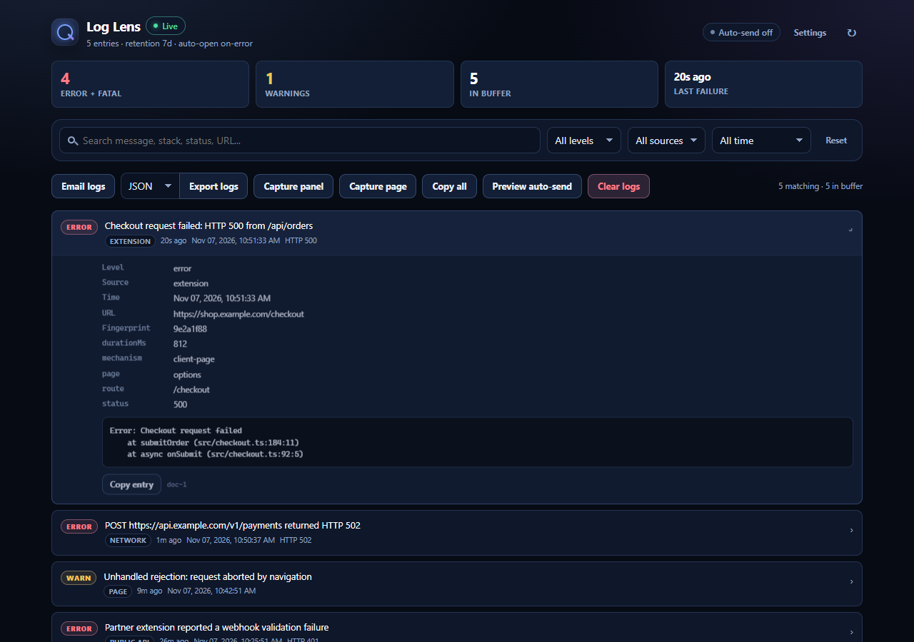
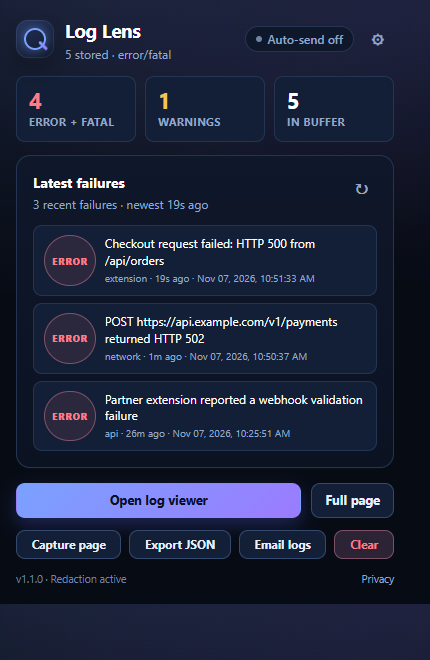
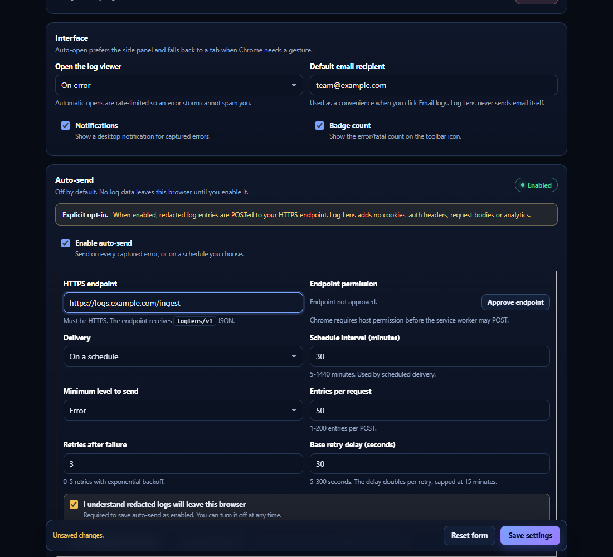
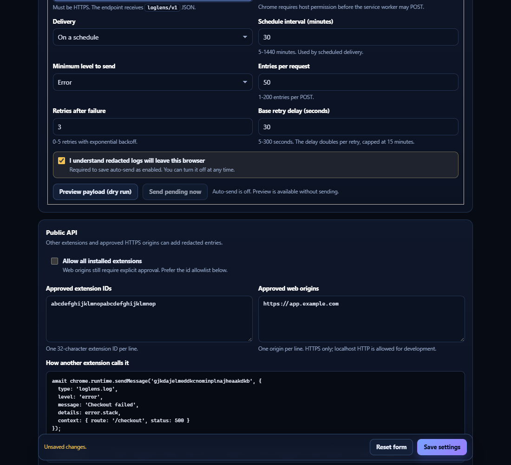
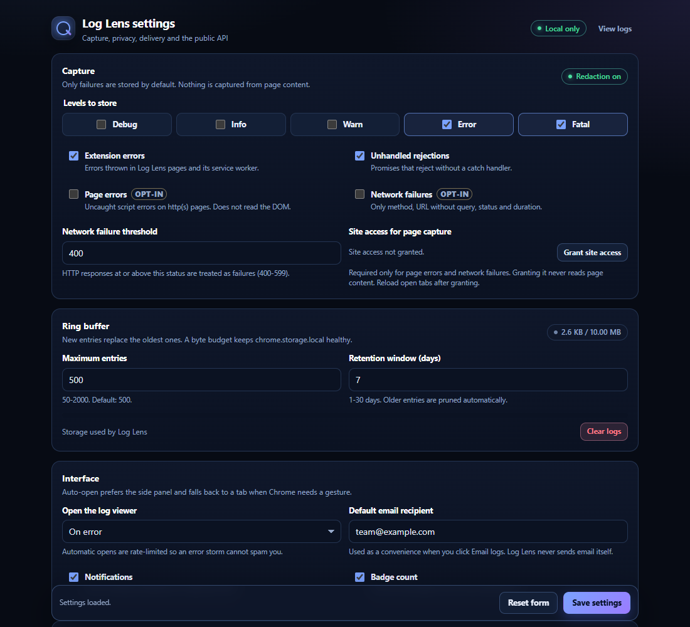

# Log Lens

<p align="center">
  
  
  
  
  
  
  
  
  
  
  
  
  
  
  
  
  
  
  
  
  
  
  
  
  
  
</p>

<div align="center">
  <h3>
    <a href="#installation--setup">Install</a>
    •
    <a href="https://github.com/malikrajat/log-lens">Source Code</a>
    •
    <a href="https://github.com/malikrajat/log-lens/releases">Download ZIP</a>
    •
    <a href="./privacy_policy.html">Privacy Policy</a>
    •
    <a href="./CHANGELOG.md">Changelog</a>
  </h3>
</div>

<div align="center">
  <p>
    <strong>Private by Default</strong> ·
    <strong>Manifest V3</strong> ·
    <strong>Local-First</strong> ·
    <strong>Opt-In Delivery</strong> ·
    <strong>Zero Telemetry</strong>
  </p>
</div>

## See It In Action

<div align="center">

  

</div>

## Table of Contents

- [Quick Start](#quick-start)
- [Features](#features)
- [Quick Start Guide](#quick-start-guide)
- [What Gets Captured](#what-gets-captured)
- [Auto-Open](#auto-open)
- [Auto-Send (Opt-In)](#auto-send-opt-in)
- [Email & Export](#email--export)
- [Screenshots](#screenshots)
- [Privacy & Redaction](#privacy--redaction)
- [Public API](#public-api)
- [UI Overview](#ui-overview)
- [Permissions](#permissions)
- [Code Examples](#code-examples)
- [Documentation](#documentation)
- [Installation & Setup](#installation--setup)
- [Performance Optimization](#performance-optimization)
- [Testing Examples](#testing-examples)
- [Migration Guide](#migration-guide)
- [Troubleshooting](#troubleshooting)
- [API Reference Quick Start](#api-reference-quick-start)
- [Best Practices](#best-practices)
- [FAQ](#faq)
- [Development](#development)
- [Changelog](#changelog)
- [License](#license)
- [Support This Project](#support-this-project)
- [Support and Community](#support-and-community)

## Install & Explore

| | |
| --- | --- |
| <a href="#installation--setup"></a><br/><br/><sub><b>Local Build</b></sub><br/><sub>Build the extension and load <code>dist/</code></sub> | <a href="https://github.com/malikrajat/log-lens/releases"></a><br/><br/><sub><b>Release Artifact</b></sub><br/><sub>Unzip and load it as an unpacked extension</sub> |
| <a href="#quick-start-guide"></a><br/><br/><sub><b>First Run</b></sub><br/><sub>Install, capture an error and read it</sub> | <a href="./privacy_policy.html"></a><br/><br/><sub><b>Privacy Policy</b></sub><br/><sub>What is collected, and what never is</sub> |
| <a href="https://github.com/malikrajat/log-lens"></a><br/><br/><sub><b>GitHub Repository</b></sub><br/><sub>Star, fork and contribute</sub> | <a href="./CHANGELOG.md"></a><br/><br/><sub><b>Release Notes</b></sub><br/><sub>Every change, version by version</sub> |

## Quick Start

**Log Lens** is a production-ready Chrome Manifest V3 extension that automatically captures error and failure logs, redacts secrets, stores them in a bounded local ring buffer, shows them in a live side panel, and lets you email, export, screenshot or send them to a collector you control.

It is private by default: no analytics, no telemetry, no remote code, and no log data leaves the browser until you explicitly enable auto-send. Extension errors and unhandled rejections are captured out of the box; page errors, network failures and delivery are opt-in.

### Installation

```bash
pnpm install
pnpm build
```

1. Open `chrome://extensions`.
2. Enable **Developer mode**.
3. Click **Load unpacked**.
4. Select the generated `dist/` folder.

The options page opens on first install so you can review the defaults. Page capture and auto-send are off.

### Basic Usage

There is no instrumentation to write for the extension's own logs. Once Log Lens is loaded it watches for extension errors and unhandled rejections, redacts them, and appends them to the local buffer.

Open the viewer from the toolbar popup or with **`Alt+Shift+L`**. The side panel shows the counts, filters, expandable stack traces and every manual action in one place.

```ts
// Optional: let another extension submit a redacted log entry.
// Approve the sender first under Settings → Public API.
const response = await chrome.runtime.sendMessage('<log-lens-extension-id>', {
  type: 'loglens.log',
  level: 'error',
  message: 'Checkout failed',
  details: error.stack,
  context: { route: '/checkout', status: 500 },
  url: 'https://app.example.com/checkout',
});
```

No backend, no account and no upload are required. Extension and page logs stay in `chrome.storage.local` until you export, email or explicitly send them.

---

## Features

- **Automatic extension error capture**: Errors thrown in Log Lens pages and its service worker are stored with message, stack and small structured context
- **Unhandled rejection capture**: Promises that reject without a catch handler are recorded without extra wiring
- **Opt-in page errors**: Uncaught script errors and unhandled rejections on `http(s)` pages, including filename, line, column and rejection reason — page content and DOM text are never read
- **Opt-in network failures**: `fetch` and `XMLHttpRequest` failures are observed in the MAIN world with method, query-free URL, status and duration only
- **Failure-only defaults**: `error` and `fatal` are stored by default; `debug`, `info` and `warn` are configurable per installation
- **Bounded ring buffer**: `chrome.storage.local` with configurable maximum entries, retention window and a 4.5 MB byte budget
- **Privacy pipeline**: Bearer headers, tokens, API keys, passwords, JWTs, cookies, private keys and URL credentials are redacted before storage, export, email or sending
- **Live side-panel viewer**: Search, level/source/time filters, expandable entries, live storage updates and paged rendering
- **Auto-open**: Never, on error or always; prefers `chrome.sidePanel` and falls back to a `logs.html` tab when Chrome requires a user gesture
- **Opt-in auto-send**: Immediate or scheduled HTTPS POST, endpoint permission checks, explicit consent, exponential-backoff retries and a dry-run preview
- **Manual actions**: Email logs, export JSON/CSV/text, capture the panel or visible page, copy all and clear logs
- **Complete UI**: Popup summary, side-panel/full-page log viewer, options page, error-count badge, notifications and the `Alt+Shift+L` shortcut
- **Public API**: `chrome.runtime.onMessageExternal` for approved extensions and approved HTTPS origins, with ping and capability discovery
- **No dependencies at runtime**: There are no runtime dependencies; every script, style and icon is bundled locally
- **No analytics, telemetry or remote code**: The extension pages use `script-src 'self'` and never load a third-party script
- **Strict TypeScript**: `strict`-mode source, typed message wrappers and a typecheck that also rejects unused code
- **Deterministic tests**: `node:test` unit suites for the core modules and Playwright E2E tests with the built extension loaded
- **Verified packaging**: The build checks every referenced file, module import and CSP rule before writing `dist/`; `pnpm zip` produces a release archive

---

## Quick Start Guide

### 1. Installation

Choose your preferred route:

```bash
# From source
git clone https://github.com/malikrajat/log-lens.git
cd log-lens
pnpm install
pnpm build

# Or build the distributable ZIP
pnpm zip
```

Load the resulting `dist/` directory through **chrome://extensions → Load unpacked**. The ZIP produced by `pnpm zip` can be uploaded to the Chrome Web Store or unzipped and loaded the same way.

Requirements:

- Chrome 116 or newer (side panel support)
- Node.js 24 or newer for building, unit tests and E2E tests
- pnpm 10 or newer

### 2. Review the Defaults

| Setting | Default | Notes |
| --- | --- | --- |
| Levels to store | `error`, `fatal` | Add `warn`, `info` or `debug` if you need them |
| Extension errors | On | Can be disabled in Capture settings |
| Unhandled rejections | On | Can be disabled in Capture settings |
| Page errors | Off | Requires site access and a page reload |
| Network failures | Off | Requires site access and a page reload |
| Auto-open | On error | Never, on error or always |
| Auto-send | Off | Requires an HTTPS endpoint, approval and consent |
| Ring buffer | 500 entries, 7 days, 4.5 MB | All three limits apply |
| Notifications | On | Error and fatal entries only |
| Public API | No senders approved | Add extension ids or HTTPS origins explicitly |

The options page writes these values to `chrome.storage.local` under `ll_settings`. Invalid or corrupt values are normalised back to safe defaults on read.

### 3. Capture Your First Error

Open the log viewer, then run this in DevTools on a Log Lens page:

```js
setTimeout(() => {
  throw new Error('Log Lens smoke test');
}, 0);
```

The entry appears in the viewer, increments the toolbar badge and triggers the optional notification. Service worker and extension-page failures follow the same path.

### 4. Read the Log Viewer

The viewer is designed for a busy buffer:

- **Search** matches the message, stack, status and URL.
- **Level**, **source** and **time** filters narrow the result set.
- **Expand** a row to see the full stack trace, redacted context and URL.
- **Show more** pages through large buffers without rendering everything at once.
- **Live updates** refresh the view when new entries are stored.

The summary row shows `error + fatal`, warnings, total entries and the last failure. The status line repeats the retention window and auto-open mode.

### 5. Capture Page Errors and Network Failures

1. Open **Settings → Capture**.
2. Enable **Page errors** and/or **Network failures**.
3. Click **Grant site access** and accept the Chrome prompt.
4. Reload any open tabs you want to observe.

Page capture records only the error message/stack and the network method, query-free URL, status and duration. It never reads the DOM, form data, request headers, request bodies or response bodies.

### 6. Deliver the Evidence

| Goal | Action |
| --- | --- |
| Tell a teammate | **Email logs** opens a preview dialog, then your mail app with a `mailto:` digest |
| Attach a file to a ticket | **Export logs** writes JSON, CSV or text locally |
| Show the exact UI state | **Capture panel** saves the viewer as a 2× PNG |
| Show the page that failed | **Capture page** saves the visible tab as a PNG |
| Keep a local copy | **Copy all** copies the filtered entries as text |
| Start fresh | **Clear logs** empties the ring buffer after confirmation |
| Send to your own collector | Enable **Auto-send** with consent and an approved HTTPS endpoint |

### 7. Send Logs from Another Extension or Web App

1. Open **Settings → Public API**.
2. Add the sender's 32-character extension id, or enable **Allow all installed extensions**.
3. For web apps, add the exact HTTPS origin (HTTP is accepted only for `localhost` and `127.0.0.1`).
4. Send a `loglens.log` message.

```ts
// Another extension
const response = await chrome.runtime.sendMessage('<log-lens-extension-id>', {
  type: 'loglens.log',
  level: 'error',
  message: 'Checkout failed',
  details: error.stack,
  context: { route: '/checkout', status: 500 },
  url: 'https://app.example.com/checkout',
});

// Approved web origin
chrome.runtime.sendMessage(
  '<log-lens-extension-id>',
  {
    type: 'loglens.log',
    level: 'warn',
    message: 'Payment widget timed out',
    context: { widget: 'payment', durationMs: 8000 },
  },
  (reply) => console.log(reply),
);
```

The same redaction and retention pipeline applies to API submissions. Unapproved senders receive `{ "ok": false, "error": "not-approved", "reason": "..." }`.

---

## What Gets Captured

| Source | Default | How to enable | What is stored |
| --- | --- | --- | --- |
| Extension errors | On | Settings → Capture (on by default) | Message, stack, small context |
| Unhandled rejections | On | Settings → Capture (on by default) | Message, stack, small context |
| Page errors | Off | Settings → Capture → Page errors + host permission | Message, stack, filename, line/column, rejection reason type |
| Network failures | Off | Settings → Capture → Network failures + host permission | Method, query-free URL, status, duration |
| Public API | When approved | Settings → Public API | Caller-supplied, redacted entry |

Only levels selected in **Settings → Capture → Levels to store** are persisted. The default is **error** and **fatal**. This is why a 404 warning is not stored until you add `warn`, for example.

The ring buffer automatically removes entries older than the retention window and trims the oldest entries when the maximum count or byte budget is reached.

### What is deliberately not captured

Log Lens never captures or stores cookies, form data, request headers, request bodies, response bodies, page content or DOM text. Page capture records only the error message/stack and network method, query-free URL, status and duration.

---

## Auto-Open

Choose **Settings → Interface → Open the log viewer**:

- **Never** — do nothing automatically.
- **On error** — open for `error` and `fatal` entries (default).
- **Always** — open for any captured entry.

Log Lens first tries `chrome.sidePanel.open()`. Chrome requires a user gesture for side-panel opens, so an automatic open commonly fails. Log Lens then opens `logs.html` in a tab instead. Automatic opens are rate-limited to one every 30 seconds and reuse an existing Log Lens tab when possible.



---

## Auto-Send (Opt-In)

Auto-send is **disabled by default** and cannot be enabled without all three of the following:

1. A valid **HTTPS** endpoint.
2. Chrome host permission for that endpoint (click **Approve endpoint** or save the settings and accept the prompt).
3. Ticking **I understand redacted logs will leave this browser**.

Choose **immediately on error** or a schedule (5–1440 minutes). Every request is a JSON `POST` with:

```json
{
  "schema": "loglens/v1",
  "product": "Log Lens",
  "version": "1.1.0",
  "sentAt": "2026-11-07T12:00:00.000Z",
  "reason": "immediate",
  "count": 1,
  "entries": [
    {
      "id": "…",
      "timestamp": 1794062400000,
      "level": "error",
      "source": "extension",
      "message": "Checkout failed",
      "details": "stack trace…",
      "context": { "route": "/checkout", "status": 500 },
      "url": "https://shop.example.com/checkout",
      "fingerprint": "9e2a1f88"
    }
  ]
}
```

Requests use `credentials: 'omit'`, `cache: 'no-store'`, `redirect: 'error'`, `referrerPolicy: 'no-referrer'`, a 15-second timeout and no auth headers. The response body is never read. Failed requests retry with exponential backoff, capped at 15 minutes, up to the configured retry count. Changing the endpoint or disabling auto-send clears queued batches so old data cannot be sent to a new destination.

Delivery settings:

| Setting | Default | Range |
| --- | --- | --- |
| Mode | `immediate` | `immediate` or `scheduled` |
| Interval | 15 minutes | 5–1440 minutes |
| Minimum level | `error` | `debug` to `fatal` |
| Batch size | 50 entries | 1–200 entries |
| Retries | 3 | 0–5 |
| Retry delay | 30 seconds | 5–300 seconds |
| Request timeout | 15 seconds | Fixed |
| Pending batches | 20 maximum | Oldest batches are dropped first |

**Preview payload (dry run)** builds the exact JSON in the options page without sending anything. **Send pending now** is a separate explicit action.



---

## Email & Export

### Email logs

Click **Email logs** in the log viewer. Log Lens builds a redacted digest of the current filtered entries and opens a preview dialog with the recipient, subject and body. You can copy the body or open your default mail application with a `mailto:` link. Nothing is emailed automatically and no attachment is created.

Use **Export logs** when you need the complete file instead of a digest.

### Export logs

The viewer exports the current filtered result as:

- **JSON** — a versioned `loglens/export/v1` document with privacy flags and entries.
- **CSV** — spreadsheet-friendly columns.
- **Text** — a readable digest.

Exports and screenshots are generated and downloaded locally with a `log-lens-<timestamp>` file name.

```json
{
  "schema": "loglens/export/v1",
  "product": "Log Lens",
  "version": "1.1.0",
  "exportedAt": "2026-11-07T12:00:00.000Z",
  "count": 1,
  "privacy": {
    "redacted": true,
    "cookiesCaptured": false,
    "formDataCaptured": false,
    "pageContentCaptured": false,
    "requestHeadersCaptured": false,
    "requestBodiesCaptured": false
  },
  "entries": []
}
```

---

## Screenshots

- **Capture panel** serialises the rendered viewer through an SVG `foreignObject` (DOM-to-image) and downloads a PNG at 2× scale.
- **Capture page** asks Chrome for `captureVisibleTab`, requesting optional host access if needed, and downloads the visible tab as a PNG.

The panel capture includes only the Log Lens panel, not the page underneath. The page capture is the active visible tab; when the side panel is open, that is normally the page you are debugging.

---

## Privacy & Redaction

Log Lens **never captures or stores** cookies, form data, request headers, request bodies, response bodies, page content or DOM text. Page capture records only the error message/stack and network method, query-free URL, status and duration.

Before storage, export, email or sending, the redactor removes:

- `Authorization` / `Proxy-Authorization` bearer, basic and token values
- Cookies and session ids
- Passwords, passphrases, client secrets and private keys
- API keys and common provider tokens (OpenAI, GitHub, Slack, AWS, Google, Stripe and others)
- JWTs and signed URL credentials
- Sensitive query parameters and URL userinfo

URLs are reduced to origin + path; query strings and fragments are dropped. Context values are redacted recursively, truncated and capped to a small number of keys.

There are **no analytics, telemetry, ads or third-party scripts**. The extension contains no remote code. See [privacy_policy.html](privacy_policy.html) for the full policy.

---

## Public API

Other extensions can send logs through `chrome.runtime.onMessageExternal`. Approval is explicit:

1. Open **Settings → Public API**.
2. Add the sender's 32-character extension id, or enable **Allow all installed extensions**.
3. For web apps, add the exact HTTPS origin (localhost HTTP is allowed for development).

The receiving extension id is visible in `chrome://extensions` and is injected into the code sample on the options page.

### From another extension

```ts
const response = await chrome.runtime.sendMessage('<log-lens-extension-id>', {
  type: 'loglens.log',
  level: 'error',
  message: 'Checkout failed',
  details: error.stack,
  context: { route: '/checkout', status: 500 },
  url: 'https://app.example.com/checkout',
});
```

### From an approved web origin

```ts
chrome.runtime.sendMessage(
  '<log-lens-extension-id>',
  {
    type: 'loglens.log',
    level: 'warn',
    message: 'Payment widget timed out',
    context: { widget: 'payment', durationMs: 8000 },
  },
  (response) => console.log(response),
);
```

### API messages

| Type | Purpose |
| --- | --- |
| `loglens.log` | Add a redacted entry. Requires sender approval. |
| `loglens.ping` | Health check; returns product, version and schema. |
| `loglens.capabilities` | Returns accepted message type, levels and privacy summary. |

A successful add returns:

```json
{
  "ok": true,
  "stored": 1,
  "ignored": false,
  "ids": ["…"],
  "source": "approved-extension"
}
```

Unapproved senders get `{ "ok": false, "error": "not-approved", "reason": "..." }`. Invalid payloads, overlong messages and rate limits (60 entries/minute per sender) are rejected. Levels disabled in settings are accepted but ignored with `"ignored": true`. The same redaction and retention pipeline applies.



---

## UI Overview

- **Popup** — counts, latest failures, auto-send state, and quick capture/export/email/clear actions.
- **Log viewer** (`logs.html`, also the side panel) — search, filters, expandable entries with stack traces and context, all manual actions, and live updates.
- **Options** (`options.html`) — capture, ring buffer, interface, auto-send, public API and privacy controls.
- **Badge** — number of error/fatal entries in the buffer, red when non-zero.
- **Notifications** — optional error notification; clicking it opens the viewer.
- **Shortcut** — `Alt+Shift+L` opens the viewer. Configure it at `chrome://extensions/shortcuts`.



---

## Permissions

| Permission | Why Log Lens needs it |
| --- | --- |
| `storage` | Ring buffer, settings and the pending-send queue |
| `alarms` | Retention, scheduled sending and retry backoff |
| `notifications` | Optional error notification |
| `sidePanel` | Preferred log viewer |
| `scripting` | Register the opt-in page-capture content script |
| `activeTab` | Visible-tab screenshot after a user gesture |
| `clipboardWrite` | Copy all / copy entry |
| Optional HTTP(S) host access | Page errors/network capture, page screenshots and the auto-send endpoint |

Log Lens does **not** request `tabs`, `webRequest`, `cookies`, `history`, `bookmarks`, `downloads` or `<all_urls>` at install time. Optional access is requested only when you enable page capture, capture a page screenshot or approve an auto-send endpoint.

---

## Code Examples

Every recipe below is short enough to copy directly. The linked sections contain the full context.

| Example | Description | Section |
| --- | --- | --- |
| **First Run** | Build, load `dist/` and capture an extension error | [Quick Start Guide](#quick-start-guide) |
| **Capture Page Errors** | Enable page capture, grant access and reload tabs | [Quick Start Guide](#5-capture-page-errors-and-network-failures) |
| **Network Failures** | Record 4xx/5xx responses and transport errors with a status threshold | [What Gets Captured](#what-gets-captured) |
| **Auto-Send Payload** | Inspect the exact JSON before sending it anywhere | [Auto-Send](#auto-send-opt-in) |
| **Email Digest** | Preview, copy or open a redacted digest in your mail app | [Email & Export](#email--export) |
| **JSON / CSV / Text Export** | Download the filtered buffer locally | [Email & Export](#email--export) |
| **Panel & Page Screenshots** | Save the viewer or the visible page as a PNG | [Screenshots](#screenshots) |
| **Public API from an Extension** | Send a redacted entry from another extension | [Public API](#public-api) |
| **Public API from the Web** | Send from an approved HTTPS origin | [Public API](#public-api) |
| **Privacy Pipeline** | See exactly which values are redacted and which are never captured | [Privacy & Redaction](#privacy--redaction) |
| **Settings Reference** | Every setting, default and range | [API Reference Quick Start](#api-reference-quick-start) |
| **Troubleshooting** | Diagnose capture, delivery and permission problems | [Troubleshooting](#troubleshooting) |

[Back to top](#log-lens)

---

## Documentation

| Documentation | Description |
| --- | --- |
| **[Quick Start Guide](#quick-start-guide)** | Install, capture, read and deliver logs |
| **[What Gets Captured](#what-gets-captured)** | Sources, levels, defaults and retention |
| **[Auto-Open](#auto-open)** | Side-panel behaviour, fallback and cooldowns |
| **[Auto-Send](#auto-send-opt-in)** | Consent, endpoint approval, payload and retries |
| **[Email & Export](#email--export)** | Digest, JSON, CSV and text output |
| **[Screenshots](#screenshots)** | Panel and visible-page capture |
| **[Privacy & Redaction](#privacy--redaction)** | The redaction pipeline and hard privacy boundaries |
| **[Public API](#public-api)** | Approved senders, message types and responses |
| **[Permissions](#permissions)** | Every permission and why it exists |
| **[API Reference](#api-reference-quick-start)** | Settings, limits, outputs and manual actions |
| **[Development](#development)** | Commands, architecture, tests and packaging |
| **[Troubleshooting](#troubleshooting)** | Common failures and their fixes |
| **[FAQ](#faq)** | Questions that come up most often |

---

## Installation & Setup

For a local build:

```bash
git clone https://github.com/malikrajat/log-lens.git
cd log-lens
pnpm install
pnpm build
```

Then:

1. Open `chrome://extensions`.
2. Enable **Developer mode**.
3. Click **Load unpacked**.
4. Select the generated `dist/` folder.

The options page opens on first install. Page capture and auto-send are off; extension errors and unhandled rejections are already being captured.

### Install from a ZIP

```bash
pnpm zip
```

The package is written to `log-lens-1.1.0.zip`. Upload it to the Chrome Web Store, or unzip it and load the folder as an unpacked extension.

### Requirements

- Chrome 116 or newer (side panel support)
- Node.js 24 or newer for building and unit tests
- pnpm 10 or newer

### First-run checklist

- Review **Settings → Capture** and confirm the levels you want to store.
- Decide whether page errors and network failures are needed.
- Set the auto-open mode.
- Leave auto-send off unless you have an HTTPS collector and explicit consent.
- Add public API senders only when you trust them.

---

## Usage

For day-to-day use, see the [Quick Start Guide](#quick-start-guide). For every setting, default and range, see the [API Reference](#api-reference-quick-start).

The short version:

1. Install and open the viewer.
2. Reproduce the failure.
3. Search and filter to the relevant entry.
4. Export, email, screenshot or send the redacted result.
5. Clear the buffer when you no longer need it.

---

## Changelog

See [CHANGELOG.md](./CHANGELOG.md) for release history and updates.

### Latest Release

Check the [releases page](https://github.com/malikrajat/log-lens/releases) for the most recent version and changes.

Version 1.1.0 is the production release with auto-capture, auto-open, opt-in delivery, screenshots, the public API, the privacy pipeline, tests and packaging.

---

## License

This project is licensed under the MIT License - see the [LICENSE](LICENSE) file for details.

**TL;DR:** You can use this extension freely in commercial and personal projects.

### MIT License Summary

**You can:**

- Use commercially
- Modify the code
- Distribute
- Use privately

**You must:**

- Include the license and copyright notice

**You cannot:**

- Hold the author liable

---

## FAQ

<details>
<summary><strong>What exactly does Log Lens capture?</strong></summary>

By default it captures errors thrown in the extension's own pages and service worker, plus unhandled promise rejections. You can opt in to uncaught page errors and failed network requests. Every source is redacted and truncated before it reaches storage.

</details>

<details>
<summary><strong>Does it send data anywhere or need a backend?</strong></summary>

**No.** The extension contains no endpoints, no account and no analytics. Logs are measured and stored locally in `chrome.storage.local`. Nothing leaves the browser until you explicitly enable auto-send, email a digest or export a file yourself.

</details>

<details>
<summary><strong>What is stored in the ring buffer?</strong></summary>

Each entry contains a level, source, message, optional stack/details, a small redacted context object, an optional query-free URL, a timestamp and a fingerprint used for grouping. The buffer is capped by entry count, retention days and a 4.5 MB byte budget.

</details>

<details>
<summary><strong>Does it read the page DOM, cookies, headers or form data?</strong></summary>

**No.** Page capture observes uncaught errors and the request method, URL, status and duration. It never reads DOM text, form data, cookies, request headers, request bodies or response bodies.

</details>

<details>
<summary><strong>Which Chrome versions and platforms are supported?</strong></summary>

Chrome 116 or newer on desktop. The side panel is the preferred viewer; when Chrome requires a gesture, Log Lens falls back to a normal `logs.html` tab. Incognito is not allowed by the manifest.

</details>

<details>
<summary><strong>Why is a 404 warning not stored?</strong></summary>

Only levels selected in **Settings → Capture → Levels to store** are persisted, and the default is **error** and **fatal**. A 404 is classified as `warn`, so add `warn` to the stored levels if you want 4xx responses in the buffer.

</details>

<details>
<summary><strong>How do I capture page errors or network failures?</strong></summary>

Open **Settings → Capture**, enable the source, click **Grant site access** and accept the Chrome prompt, then reload the tabs you want to observe. The permission is requested only for `http(s)` pages and can be removed again.

</details>

<details>
<summary><strong>Why did the side panel not open automatically?</strong></summary>

Chrome requires a user gesture for `chrome.sidePanel.open()`. Log Lens tries the side panel first and then opens `logs.html` in a tab. Automatic opens are rate-limited to one every 30 seconds. Use the toolbar button or `Alt+Shift+L` when you want an immediate open.

</details>

<details>
<summary><strong>How does auto-send consent work?</strong></summary>

Auto-send stays disabled until you provide an HTTPS endpoint, approve its host permission and tick the consent checkbox. Settings only remain enabled while both the endpoint and the stored consent timestamp are valid. A dry-run preview is always available without sending.

</details>

<details>
<summary><strong>Can other extensions or web apps send logs to Log Lens?</strong></summary>

**Yes, when approved.** Add the sender's extension id or exact HTTPS origin under **Settings → Public API**, then send a `loglens.log` message. Unapproved senders receive `not-approved`; approved senders still pass through the same redaction, level and retention pipeline.

</details>

<details>
<summary><strong>Can I export or email logs without sending them anywhere?</strong></summary>

**Yes.** Email creates a local `mailto:` digest, and export writes JSON, CSV or text through a local download. Screenshots are generated locally too. None of these actions touch a network endpoint.

</details>

<details>
<summary><strong>Why did my logs disappear?</strong></summary>

The retention window, maximum entry count or 4.5 MB byte budget trimmed them. Adjust **Settings → Ring buffer**. Clearing logs also empties the buffer immediately after confirmation.

</details>

<details>
<summary><strong>Does Log Lens work in incognito?</strong></summary>

No. The manifest sets `"incognito": "not_allowed"` so the extension does not observe private browsing sessions.

</details>

<details>
<summary><strong>Is this extension free for commercial use?</strong></summary>

**Yes.** Licensed under **MIT** - use it in commercial products, internal tools and client projects. You only need to retain the copyright notice. See the [License](#license) section.

</details>

---

## Performance Optimization

### Optimization Tips

#### 1. Keep the Failure-Only Default

```text
Levels to store: error, fatal
```

Most teams never need `debug`, `info` or `warn` in the persistent buffer. Keeping the default reduces storage writes, keeps the viewer focused and makes the badge meaningful.

#### 2. Turn Page Capture On Only While Debugging

Page errors and network failures require optional host access. Leave them off for everyday use, enable them while investigating a specific site, and remove access when you are done. Reload open tabs after changing the permission.

#### 3. Tune the Network Threshold

The default `networkFailureMinStatus` is `400`. Raise it when you only care about server failures, or add `warn` to stored levels when 4xx responses matter.

#### 4. Cap Retained Data

```text
Maximum entries: 500
Retention: 7 days
Byte budget: 4.5 MB
```

The oldest entries are dropped first. Export before clearing if the data matters, and keep the retention window short enough that the buffer stays useful.

#### 5. Batch or Schedule Auto-Send

Immediate sending is best for low-volume failures. For busy applications, use a scheduled window and a batch size that matches your collector. The queue is capped at 20 pending batches and a single send lock prevents concurrent flushes.

#### 6. Prefer the Panel Screenshot for UI Evidence

Panel capture serialises only the viewer, while page capture asks Chrome for the visible tab. The panel is smaller, more predictable and avoids exposing unrelated page content.

#### 7. Clear After Exporting

The viewer is a debugging surface, not an archive. Export the filtered result, then clear the buffer so the next investigation starts clean.

---

## Testing Examples

### Unit Testing with `node:test`

The core is DOM-free and chrome-free, so redaction and ring-buffer behaviour can be tested directly with Node's built-in test runner and type stripping.

```js
import assert from 'node:assert/strict';
import test from 'node:test';
import { createLogEntry } from '../../src/core/ring-buffer.ts';

test('redacts secrets and drops query strings', () => {
  const entry = createLogEntry({
    level: 'error',
    source: 'page',
    message: 'Authorization: Bearer supersecret',
    details: 'api_key=abc123',
    context: { authorization: 'Bearer xyz', status: 500 },
    url: 'https://example.com/checkout?token=secret',
  });

  assert.equal(entry.url, 'https://example.com/checkout');
  assert.equal(entry.context?.authorization, '[REDACTED]');
  assert.equal(entry.context?.status, 500);
  assert.ok(!JSON.stringify(entry).includes('supersecret'));
  assert.ok(!JSON.stringify(entry).includes('abc123'));
});
```

### End-to-End Testing with Playwright

The E2E suite loads the built `dist/` folder into a persistent Chromium profile and drives the real extension pages.

```ts
import { chromium, expect, test } from '@playwright/test';
import { resolve } from 'node:path';

const extensionPath = resolve('dist');

test('loads the built extension and opens the viewer', async () => {
  const context = await chromium.launchPersistentContext('', {
    args: [
      `--disable-extensions-except=${extensionPath}`,
      `--load-extension=${extensionPath}`,
    ],
  });

  let [worker] = context.serviceWorkers();
  if (!worker) worker = await context.waitForEvent('serviceworker');

  const extensionId = new URL(worker.url()).host;
  const page = await context.newPage();
  await page.goto(`chrome-extension://${extensionId}/logs.html`);

  await expect(page.locator('#log-shell')).toBeVisible();
  await context.close();
});
```

The workspace runs unit tests with **`node:test`** and browser tests with **Playwright**. Set `HEADLESS=1` to run E2E headless; the default is headed because some Chromium builds only support extension side-loading in headed mode.

---

## Migration Guide

### From Console Logging and Debugger Sessions

| Manual approach | Log Lens |
| --- | --- |
| `console.log(error)` and a lost DevTools session | Automatic extension error and rejection capture |
| Copying stack traces into a text file | One-click JSON, CSV or text export |
| Taking ad-hoc screenshots | Built-in panel and visible-page capture |
| Pasting logs into an email | Redacted `mailto:` digest with a preview |
| Keeping everything forever | Bounded ring buffer with retention controls |

### From an Error-Monitoring SDK

| SDK concept | Log Lens |
| --- | --- |
| Global agent / auto-init script | Install the extension; no app code required |
| Backend ingestion endpoint | Local buffer by default; opt-in HTTPS POST |
| Vendor dashboards | Side-panel viewer, popup summary and exports |
| Always-on delivery | Explicit consent, endpoint approval and a dry-run preview |
| Unlimited cloud retention | Bounded local retention, 4.5 MB budget |

### From Log Lens 1.0.0 to 1.1.0

1.1.0 is a minor release, so the local settings and log schemas remain compatible:

- Settings are normalised on read, so missing new fields fall back to safe defaults.
- Page capture, network failures and auto-send are off by default.
- The public API, screenshots, notifications, badge and shortcut are available without changing stored log entries.
- No migration step is required; load the new build and review **Settings → Capture** if you want the new opt-in sources.

---

## Troubleshooting

| Problem | Fix |
| --- | --- |
| Page errors are not captured | Enable **Page errors**, save, grant site access and reload the page. |
| Network failures are not captured | Enable **Network failures**, confirm the status is at or above the threshold, and add `warn` to levels for 4xx responses. |
| Side panel did not open automatically | Chrome requires a gesture. Log Lens falls back to a `logs.html` tab; use the toolbar button or `Alt+Shift+L`. |
| Auto-send stays off after saving | Approve the endpoint origin and tick the consent checkbox. Check the status line in Settings. |
| Auto-send fails | Verify HTTPS, the endpoint response code, retries and network access. Use the dry-run preview to inspect the payload. |
| Screenshot permission error | Click **Capture page** again and accept the host-access prompt, or grant site access in Settings. |
| Public API returns `not-approved` | Add the sender's extension id or web origin under **Settings → Public API**. |
| Public API returns `ignored: true` | The submitted level is disabled in **Levels to store**. Add the level if the entry should be retained. |
| Logs disappeared | The retention window, maximum count or byte budget trimmed them. Adjust under **Settings → Ring buffer**. |
| Nothing appears in the viewer | Clear the search and filters, confirm capture is enabled, and reproduce the failure after loading the extension. |
| Badge count looks stale | Reload the extension in `chrome://extensions`, or wait for the next capture or hourly maintenance alarm to refresh it. |
| Extension errors stopped after a reload | Reload the extension in `chrome://extensions` and reproduce the failure on a Log Lens page or in the service worker. |

---

## API Reference Quick Start

### Settings Inputs

All settings are exposed through the options page and stored under `ll_settings`. Invalid types are normalised, and out-of-range numbers are clamped.

| Setting | Type | Default | Description |
| --- | --- | --- | --- |
| `levels` | `LogLevel[]` | `['error', 'fatal']` | Levels that are persisted |
| `captureExtensionErrors` | `boolean` | `true` | Capture extension page and service worker errors |
| `captureUnhandledRejections` | `boolean` | `true` | Capture unhandled promise rejections |
| `capturePageErrors` | `boolean` | `false` | Opt-in uncaught page script errors |
| `captureNetworkFailures` | `boolean` | `false` | Opt-in failed `fetch` and XHR requests |
| `networkFailureMinStatus` | `number` | `400` | Status at or above which a request is a failure (400–599) |
| `maxEntries` | `number` | `500` | Maximum retained entries (50–2000) |
| `retentionDays` | `number` | `7` | Retention window in days (1–30) |
| `autoOpen` | `'never' \| 'on-error' \| 'always'` | `'on-error'` | When to open the viewer automatically |
| `showBadge` | `boolean` | `true` | Show the error/fatal count on the toolbar icon |
| `notifyOnError` | `boolean` | `true` | Show an optional notification for failures |
| `emailRecipient` | `string` | `''` | Optional default recipient for the email digest |
| `autoSend.enabled` | `boolean` | `false` | Explicit opt-in, gated by consent and a valid endpoint |
| `autoSend.endpoint` | `string` | `''` | HTTPS collector URL |
| `autoSend.mode` | `'immediate' \| 'scheduled'` | `'immediate'` | Immediate or scheduled delivery |
| `autoSend.intervalMinutes` | `number` | `15` | Schedule interval (5–1440 minutes) |
| `autoSend.minLevel` | `LogLevel` | `'error'` | Minimum level that is sent |
| `autoSend.retryCount` | `number` | `3` | Retries after the first attempt (0–5) |
| `autoSend.retryDelaySeconds` | `number` | `30` | Base retry delay (5–300 seconds) |
| `autoSend.batchSize` | `number` | `50` | Entries per request (1–200) |
| `autoSend.consentAt` | `number \| null` | `null` | Timestamp of the explicit consent |
| `externalApi.approvedExtensions` | `string[]` | `[]` | Approved 32-character extension ids |
| `externalApi.approvedOrigins` | `string[]` | `[]` | Approved HTTPS origins |
| `externalApi.allowAllExtensions` | `boolean` | `false` | Allow any installed extension; web origins are still checked |

### Limits

| Limit | Min | Max | Default |
| --- | --- | --- | --- |
| `maxEntries` | 50 | 2000 | 500 |
| `retentionDays` | 1 | 30 | 7 |
| `networkFailureMinStatus` | 400 | 599 | 400 |
| `autoSend.intervalMinutes` | 5 | 1440 | 15 |
| `autoSend.retryCount` | 0 | 5 | 3 |
| `autoSend.retryDelaySeconds` | 5 | 300 | 30 |
| `autoSend.batchSize` | 1 | 200 | 50 |
| Request timeout | — | — | 15 seconds |
| Pending batches | — | 20 | 20 |
| Storage budget | — | — | 4.5 MB |
| Auto-open cooldown | — | — | 30 seconds |
| Notification cooldown | — | — | 30 seconds |
| Message length | — | 4000 | — |
| Details length | — | 12000 | — |
| Context size | — | 6000 chars / 20 keys | — |
| URL length | — | 2000 | — |
| Endpoint length | — | 2048 | — |
| Email length | — | 254 | — |

### Storage Keys

| Key | Contents |
| --- | --- |
| `ll_settings` | Normalised settings object |
| `ll_logs` | Bounded log entry ring buffer |
| `ll_state` | Install time, cooldowns, last send state and retry markers |
| `ll_pending_sends` | Queued auto-send batches |
| `ll_open_logs_tab` | Session-scoped tab reuse marker |

### External API Messages

| Message | Response |
| --- | --- |
| `{ type: 'loglens.log', message, level?, details?, context?, url? }` | `{ ok, stored, ignored, ids, source }` or a rejection reason |
| `{ type: 'loglens.ping' }` | `{ ok: true, product, version, schema }` |
| `{ type: 'loglens.capabilities' }` | Accepted message type, levels and privacy summary |

### Outputs

| Output | Kind | Description |
| --- | --- | --- |
| Popup | UI | Counts, latest failures, auto-send state and quick actions |
| Log viewer | UI | Side panel or full-page viewer with search, filters and actions |
| Options page | UI | Capture, ring buffer, interface, auto-send, public API and privacy |
| Toolbar badge | UI | Error/fatal count, red when non-zero |
| Notification | UI | Optional failure notification; opens the viewer |
| JSON export | File | Versioned `loglens/export/v1` document with privacy flags |
| CSV export | File | Spreadsheet-friendly columns |
| Text export | File | Readable digest |
| Email digest | `mailto:` | Redacted preview for the current filtered entries |
| Panel PNG | File | 2× capture of the viewer |
| Page PNG | File | Visible-tab capture |
| Auto-send POST | Network | Opt-in `loglens/v1` JSON payload |
| External API reply | Message | Structured success or rejection object |

### Manual Actions

| Action | Where | What it does |
| --- | --- | --- |
| Refresh | Popup, viewer | Re-reads the current snapshot |
| Open log viewer | Popup | Opens the side panel or fallback tab |
| Full page | Popup | Opens `logs.html` in a tab |
| Email logs | Popup, viewer | Builds and previews a redacted `mailto:` digest |
| Export logs | Popup, viewer | Downloads JSON, CSV or text |
| Capture panel | Viewer | Saves the viewer as a 2× PNG |
| Capture page | Popup, viewer | Saves the visible tab as a PNG |
| Copy all | Viewer | Copies the filtered entries as text |
| Preview auto-send | Viewer, options | Builds the exact payload without sending |
| Send pending now | Options | Flushes the queue immediately |
| Clear logs | Popup, viewer | Empties the ring buffer after confirmation |
| Settings | Popup, viewer | Opens the options page |

### Permissions

See the full [Permissions](#permissions) table above. The extension requests `storage`, `alarms`, `notifications`, `sidePanel`, `scripting`, `activeTab` and `clipboardWrite`; optional HTTP(S) host access is requested only for the features you turn on.

---

## Best Practices

### 1. Keep the Failure-Only Default

```text
Levels to store: error, fatal
```

The default is the right baseline for almost every installation. Add levels deliberately, and remember that `warn` is what makes 4xx responses and many browser warnings visible.

### 2. Treat Page Capture as a Temporary Instrument

Page errors and network failures are powerful and intentionally opt-in. Enable them while investigating a specific site, reload the affected tabs, and remove access when the investigation ends.

### 3. Prove Consent Before Auto-Send

Auto-send should be a deliberate production integration:

```text
HTTPS endpoint + endpoint approval + explicit consent
```

Use the dry-run preview, start with `minLevel: 'error'`, and verify the collector response before relying on it.

### 4. Approve API Senders Explicitly

Prefer an allowlist of extension ids and HTTPS origins over **Allow all installed extensions**. The public API is useful, but it is still an input surface.

### 5. Export Before Clearing

The buffer is bounded by design. If an entry matters for a ticket, export the filtered result or capture the panel before you clear the logs.

### 6. Review the Redaction Boundary

Redaction is automatic, but the safest data is data you never capture. Keep page capture off unless needed, and avoid adding sensitive values to the context you submit through the public API.

### 7. Verify the Built Package

```bash
pnpm build
pnpm verify:dist
pnpm test
pnpm test:e2e
```

`verify:dist` checks the manifest, referenced files, module imports and CSP rules. Load `dist/` only after the verification passes.

---

## Documentation

- **[Quick Start Guide](#quick-start-guide)** - Install, capture, read and deliver logs
- **[What Gets Captured](#what-gets-captured)** - Sources, levels, defaults and retention
- **[Auto-Open](#auto-open)** - Side-panel behaviour, fallback and cooldowns
- **[Auto-Send](#auto-send-opt-in)** - Consent, endpoint approval, payload and retries
- **[Email & Export](#email--export)** - Digest, JSON, CSV and text output
- **[Screenshots](#screenshots)** - Panel and visible-page capture
- **[Privacy & Redaction](#privacy--redaction)** - The redaction pipeline and privacy boundaries
- **[Public API](#public-api)** - Approved senders, message types and responses
- **[Permissions](#permissions)** - Every permission and why it exists
- **[API Reference](#api-reference-quick-start)** - Settings, limits, outputs and manual actions
- **[Development](#development)** - Commands, architecture, tests and packaging
- **[Troubleshooting](#troubleshooting)** - Common failures and their fixes

---

## Statistics

[](https://github.com/malikrajat/log-lens)
[](https://developer.chrome.com/docs/extensions/develop/migrate)
[](https://github.com/malikrajat/log-lens/issues)
[](https://github.com/malikrajat/log-lens/stargazers)
[](https://github.com/malikrajat/log-lens/blob/main/LICENSE)

---

## Support This Project

If **Log Lens** has helped you debug a Chrome extension or a stubborn page failure, please consider:

- Starring the repository so other developers can find it
- Reporting bugs with the extension version and reproduction steps
- Suggesting privacy-preserving capture improvements
- Sharing the extension with your team

**Why star this repo?**

- Help other extension developers discover a local-first debugging tool
- Support continued development and maintenance
- Show appreciation for a free, dependency-free utility
- Encourage more privacy-first developer tooling

### **Want More Quality Libraries?**

This is one of several tools I maintain. **[Explore my other JavaScript, web and extension projects](https://github.com/malikrajat?tab=repositories)** for more debugging, UI and productivity utilities.

[](https://github.com/malikrajat?tab=repositories)
[](https://github.com/malikrajat)
[](https://github.com/malikrajat/log-lens/stargazers)

---

## Support and Community

### Getting Help

| Support Channel | Link | Best For |
| --- | --- | --- |
| Bug Reports | [Report Bug](https://github.com/malikrajat/log-lens/issues/new) | Capture, permission and delivery issues |
| Feature Requests | [Request Feature](https://github.com/malikrajat/log-lens/issues/new) | New sources, filters and integrations |
| Changelog | [Release Notes](./CHANGELOG.md) | Version history and changes |
| Email | [mr.rajatmalik@gmail.com](mailto:mr.rajatmalik@gmail.com?subject=Log%20Lens%20Support) | Direct support |

### Documentation

- [GitHub Repository](https://github.com/malikrajat/log-lens)
- [Privacy Policy](./privacy_policy.html)
- [Changelog](./CHANGELOG.md)
- [Releases](https://github.com/malikrajat/log-lens/releases)

### Community

- Star the repository to show support
- Watch for updates and new releases
- Share your use cases and feedback
- Contribute code, tests or documentation

---

## Acknowledgements

Log Lens was built to make extension and page failures visible without adding a vendor, an agent or a network hop.

Special thanks to:

- **The Chrome extensions community** - for the APIs, patterns and feedback that shaped this tool
- **The Playwright and Biome teams** - for the testing and tooling that keep the extension honest
- **Contributors** - for making the extension better with every issue and pull request
- **Everyone debugging in DevTools** - for reminding us that the fastest observability tool is the one already open

---

## Other Projects

### Monitoring & Diagnostics

| Project | Description | Link |
| --- | --- | --- |
| **@codewithrajat/tracepulse** | Zero-dependency API request monitoring, timing and performance observability. Instruments `fetch()` and XHR automatically and prints colour-coded console reports or self-contained HTML/JSON exports. | [](https://www.npmjs.com/package/@codewithrajat/tracepulse) |
| **@codewithrajat/rm-logvault** | Offline-first browser error tracking, logging and one-file diagnostics export. Redacts PII before writing, stores in IndexedDB and uploads only to your own endpoint. | [](https://www.npmjs.com/package/@codewithrajat/rm-logvault) |

### Chrome Extensions

| Project | Description | Link |
| --- | --- | --- |
| **quickocr** | Chrome extension that extracts text from images using OCR technology | [](https://github.com/malikrajat/quickocr/releases) |
| **readLoude** | Chrome extension that reads web pages aloud, such as articles | [](https://github.com/malikrajat/readLoude/releases) |
| **ai-assistant-reply** | AI Chrome extension that auto-generates replies on LinkedIn posts | [](https://github.com/malikrajat/ai-assistant-reply/releases) |

### VS Code Extensions

| Project | Description | Link |
| --- | --- | --- |
| **dead-css-cleaner** | Identify and clean unused CSS styles without leaving VS Code | [](https://marketplace.visualstudio.com/items?itemName=RajatMalik.dead-css-cleaner) |
| **file-coverage-insight** | Automatically generated component file coverage on open | [](https://marketplace.visualstudio.com/items?itemName=RajatMalik.file-coverage-insight) |
| **npmDepScript** | Run npm scripts and review outdated, deprecated and vulnerable dependencies | [](https://marketplace.visualstudio.com/items?itemName=RajatMalik.npm-dep-script) |

### All Projects

- [npm: @codewithrajat](https://www.npmjs.com/~codewithrajat)
- [npm: rajatmalik](https://www.npmjs.com/~rajatmalik)
- [GitHub: @malikrajat](https://github.com/malikrajat?tab=repositories)

---

## Development

### Commands

```bash
pnpm install          # Node 24+, pnpm 10+
pnpm dev              # rebuild pages + content scripts while you work
pnpm lint             # Biome lint + import order
pnpm lint:fix         # apply safe Biome fixes
pnpm format           # format supported files
pnpm format:check     # fail if formatting drifted
pnpm typecheck        # strict tsc --noEmit + unused checks
pnpm test             # unit tests (node:test, direct TS imports)
pnpm test:e2e         # Playwright with the built extension loaded
pnpm test:all         # unit + build + E2E
pnpm build            # bundles, static files, dist verification
pnpm verify:dist      # verify the built package on its own
pnpm icons            # regenerate PNG icons
pnpm docs:images      # regenerate README screenshots from the real extension
pnpm zip              # build and write log-lens-1.1.0.zip
```

The first E2E or docs run may need Playwright's Chromium:

```bash
pnpm exec playwright install chromium
```

### Project Structure

```text
log-lens/
├── src/
│   ├── core/                  # Types, settings, redaction, ring buffer, payloads, policy
│   ├── background/            # Service worker, storage, capture, auto-open, auto-send, API
│   ├── content/               # MAIN-world instrumentation + isolated bridge
│   └── ui/
│       ├── shared/            # DOM helpers, screenshots, messaging, CSS
│       ├── popup/             # Toolbar summary
│       ├── logs/              # Side panel / full-page viewer
│       └── options/           # Settings
├── popup.html                 # Vite entry points (output at dist root)
├── logs.html
├── options.html
├── privacy_policy.html
├── tests/
│   ├── unit/                  # node:test suite
│   └── e2e/                   # Playwright with the extension loaded
├── scripts/                   # Build, tests, icons, docs, verification, ZIP
├── docs/images/               # README screenshots
├── vite.config.ts
├── vite.content.config.ts
├── vite.mainworld.config.ts
├── playwright.config.ts
├── manifest.json
├── CHANGELOG.md
├── README.md
└── LICENSE
```

### Architecture

- **Service worker** owns capture policy, storage writes, badge, notifications, auto-open, alarms and auto-send. Storage mutations are serialised to avoid lost updates.
- **Core modules** are DOM-free and chrome-free where possible, so they are unit-tested directly by Node with type stripping.
- **Content script** is split into a MAIN-world instrumentation bundle (page error, fetch and XHR hooks) and an isolated bridge. Both are classic IIFEs because Chrome content scripts cannot use ES modules. The bridge buffers early events until settings arrive and rate-limits itself.
- **UI pages** are ES modules built by Vite with shared CSS and typed message wrappers.
- **Auto-send** snapshots each batch at enqueue time; endpoint changes or disabling clears the queue. A single send lock prevents concurrent flushes.

### Unit Tests

`pnpm test` covers:

- Settings defaults, clamping, enum validation, consent gating and allowlists.
- Redaction of headers, JSON secrets, provider tokens, JWTs, private keys, URL credentials and nested context, including false-positive guards.
- Ring-buffer retention, entry caps, byte budget, filtering, counting, text and CSV serialisation.
- Auto-open modes/cooldown, notifications, auto-send eligibility, HTTP levels, retry backoff and schedule timing.
- External API approval decisions.
- Manifest shape, version consistency, icon dimensions, CSP and package scripts.

### E2E Tests

`pnpm test:e2e` launches Chromium with `dist/` loaded and verifies:

- Manifest V3 and version 1.1.0.
- Seeded log rendering, search and filter reset.
- Popup summary and latest failure.
- Defaults: page capture and auto-send off.
- A captured extension error reaches storage and updates the badge.
- Clear logs empties the ring buffer after confirmation.

Set `HEADLESS=1` to run E2E headless. The default is headed because some Chromium builds only support extension side-loading in headed mode.

### Packaging

`pnpm build` emits the extension, copies the manifest/icons/privacy page, verifies every referenced file, module import and CSP rule, then writes `dist/`. `pnpm zip` produces `log-lens-1.1.0.zip`.

---

## Author

**Rajat Malik**

Full-Stack Developer and Frontend Architect at Siemens with 14+ years building scalable enterprise platforms, specializing in micro-frontends, AI-native development, React and Angular. Author of 10+ open-source libraries and 100+ technical articles, driving innovation through developer-friendly tools, performance optimization and AI-assisted workflows.

### GET IN TOUCH

- Portfolio: [rajatmalik.dev](https://rajatmalik.dev)
- Email: [mr.rajatmalik@gmail.com](mailto:mr.rajatmalik@gmail.com)
- LinkedIn: [errajatmalik](https://linkedin.com/in/errajatmalik)
- GitHub: [@malikrajat](https://github.com/malikrajat)
- npm: [rajatmalik](https://www.npmjs.com/~rajatmalik)

### SOCIAL PRESENCE

- Threads: [rajatmalik](https://www.threads.net/@er.rajatmalik)
- Twitter/X: [rajatmalik](https://x.com/er_rajatmalik)
- BlueSky: [rajatmalik](http://devrajat.bsky.social)

### CONTENT & WRITING

- Medium: [rajatmalik](https://medium.com/@codewithrajat)
- Dev.to: [rajatmalik](https://dev.to/codewithrajat)
- Substack: [rajatmalik](https://codewithrajat.substack.com)
- Hashnode: [rajatmalik](https://hashnode.com/@codeswithrajat)

---

<p align="center">
  Made with care and love by <a href="https://rajatmalik.dev">Rajat Malik</a> for the Chrome extension community
</p>

<p align="center">
  <a href="https://github.com/malikrajat/log-lens/stargazers">Star on GitHub</a> •
  <a href="https://github.com/malikrajat/log-lens/releases">Download</a> •
  <a href="https://github.com/malikrajat/log-lens/issues">Report Issue</a> •
  <a href="./privacy_policy.html">Privacy Policy</a>
</p>

<p align="center">
  Made with dedication by <a href="https://rajatmalik.dev">Rajat Malik</a>
</p>
